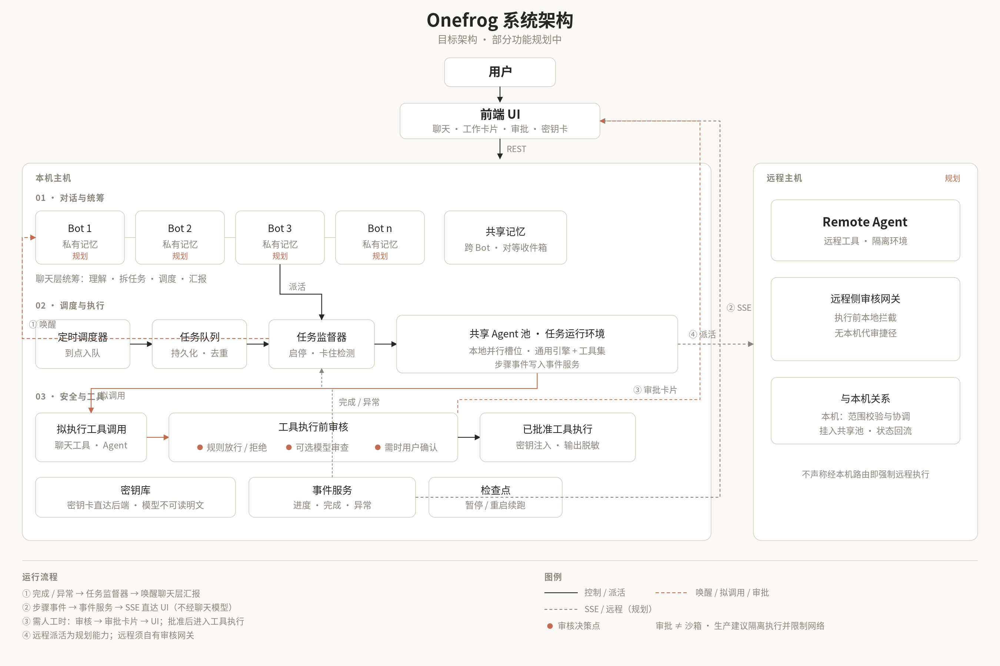

# frog bot —— 多个独立 AI 助理

frog bot 是一个能聊天、也能在后台干活的 AI 助理。它就是我们讨论过的那套架构，做成了一个能跑起来的独立项目。

点左侧 Bots 旁的「＋」创建助理，填写名称和可选职责，例如代码审查或资料整理。点头像所在的行切换助理，点行内的铅笔编辑或删除。默认 Bot 可以编辑，不能删除。删除其他 Bot 会停止它的任务和定时计划；默认只从列表里移除，聊天记录、记忆、密钥和工作区文件仍保留在磁盘上（确认框里会显示具体目录），勾选「彻底删除」才会连这些数据一起删掉。最多 32 个 Bot。每个 Bot 有独立的对话、任务队列、审批、记忆、密钥和定时计划；切换时，原 Bot 的后台任务继续运行。

所有 Bot 共用「设置 → API 渠道」。原有单 Bot 数据继续由默认 Bot 使用。新 Bot 的记录保存在 `DATA_DIR/bots/<id>/`，独立工作区在 `WORKSPACE-bots/<id>/`（默认 `./workspace-bots/<id>/`）。备份时请保留数据目录和两个工作区目录。

## 下载和使用

到 [Releases](https://github.com/llc370219/frog-bot/releases) 下载对应系统的包。有两种用法：

**本机版**（自己电脑上用）：解压后运行 `frogbot`（Windows 双击 `frogbot.exe`），浏览器会自动打开管理页面 `http://127.0.0.1:8080`，在「设置 → API 渠道」填好模型的接口地址、API Key 和模型名就能聊天。本机版只接受来自这台电脑的访问，没有登录。

**服务器版**（放在 Linux 服务器上，从任何地方用浏览器登录）：在服务器上执行一行命令：

```bash
curl -fsSL https://raw.githubusercontent.com/llc370219/frog-bot/main/scripts/install.sh | sudo bash
```

脚本会自动识别 x86_64 / arm64，从 Releases 下载最新版并校验 SHA256，装到 `/opt/frogbot`，创建专用的非 root 用户 `frogbot`，数据放在 `/var/lib/frogbot`，注册开机自启、出错自动重启的 systemd 服务，最后打印：

```
  访问地址：http://<服务器公网 IP>:8080
  用户名：  admin
  初始密码：xxxx-xxxx-xxxx-xxxx   ← 只显示这一次
```

- 可选参数写在 `sudo` 后面：`… | sudo PORT=9000 FROGBOT_USER=me bash`；`FROGBOT_PASSWORD=…` 指定初始密码；`VERSION=v0.1.2` 装指定版本。
- 再运行一次同样的命令就是**升级**，数据、账号和密码都保留。
- 忘记密码：`sudo frogbot reset-password`（打印新密码，旧的登录全部失效，不用重启服务）。登录后也可以在「设置 → 账号与登录」改密码。
- 卸载：`curl -fsSL https://raw.githubusercontent.com/llc370219/frog-bot/main/scripts/install.sh | sudo bash -s uninstall`（保留数据；最后加 `--purge` 连数据一起删）。
- 脚本**不会改防火墙**。云服务器要在安全组里放行端口（例如 `sudo ufw allow 8080/tcp`）。

> ⚠️ **HTTP 是明文**：直接用 `http://IP:端口` 登录时，密码和聊天内容在网络上不加密，路上的人能看到。建议准备一个域名，解析到服务器后用 HTTPS：
>
> ```bash
> curl -fsSL https://raw.githubusercontent.com/llc370219/frog-bot/main/scripts/install.sh | sudo DOMAIN=bot.example.com bash
> ```
>
> 这会装好 [Caddy](https://caddyserver.com) 并自动申请证书，frog bot 改为只监听本机，访问地址变成 `https://bot.example.com`（需要放行 80 和 443）。已经有 Caddy 的话，在 Caddyfile 里加一段 `bot.example.com { reverse_proxy 127.0.0.1:8080 }` 即可。

> ⚠️ **后台 agent 能在服务器上执行命令**，`shell` 工具没有真正的沙箱（systemd 只做了基本加固：非 root 用户、只能写 `/var/lib/frogbot`）。请用一台专门的 VPS，不要和重要的服务、数据放在一起。有风险的操作默认仍然要你在网页上点「批准」。

不用安装脚本也行：`./frogbot -server`（默认监听 `0.0.0.0:8080`，第一次启动时在终端打印用户名和初始密码），或者 `./frogbot -server -port 9000`。

服务器版的登录：密码用 bcrypt 哈希保存在 `数据目录/auth.json`；会话 Cookie 是 HttpOnly + SameSite=Strict（HTTPS 下加 Secure），7 天有效，改密码后旧会话全部失效；同一 IP 连续输错 5 次锁 1 分钟并逐次翻倍（最长 1 小时），全局 15 分钟内错 30 次暂停所有登录 15 分钟；所有 `/api/*`（包括 SSE 事件流和审批接口）都要登录，跨站写请求一律拒绝。

交流讨论：[Telegram 群](https://t.me/+pKQYEaxzidU4ZjZh)（与 [OneFrog](https://github.com/llc370219/onefrog) 同一交流群）

<p align="center"></p>

<p align="center"><em>目标架构示意，部分功能仍在规划中</em>（可编辑矢量图见 <a href="docs/images/architecture-minimal.svg">architecture-minimal.svg</a>）</p>


```
浏览器（React）
   │ 每个 Bot 的接口都在 /api/bots/{id}/ 下：
   │ POST messages、stop、approvals/{id}、cards/{id}、secrets、tasks/{id}/{pause|resume|cancel|retry|top|up}、
   │      uploads、regenerate、messages/{id}/edit、messages/{id}/react；GET files?path=
   │ GET  stream（SSE，一条流推送这个 Bot 的所有事件，断线带 Last-Event-ID 续传）
   │ 全局：GET/POST /api/bots、/api/settings；服务器模式另有 /login、/api/auth/*
   ▼
本机模式：只接受发往 127.0.0.1 的请求 + 拒绝跨站写请求    服务器模式：必须登录 + 拒绝跨站写请求
   ▼
Go 后端
 ├─ 聊天层：快模型 + 管理工具。每轮只回一两句话就结束，不守着 agent
 ├─ 后台 agent：onefrog（internal/onefrog），在 goroutine 里跑，可以同时跑多个
 ├─ 监工：普通 Go 代码，管排队和暂停/继续，盯 agent 事件，在任务完成/失败/需要审批时叫醒聊天层
 ├─ 定时唤醒器：无模型；持久化计划到点派任务进现有队列（前端开不开无关；后端没开就无法执行）
 └─ 事件日志：data/stream.jsonl，消息、任务、审批全靠它，重启后能恢复
```

## 一句话说清各部分

- **聊天层**（`internal/bot/chat.go`、`chattools.go`）：使用「应用设置 → 模型连接」中的模型。它不只是回话和派活，
  还有一组**快速读写工具**，简单的问题自己就能查清楚再回答（见下面"聊天层能做什么"）。
  **它没有"批准"工具，也不能执行命令。**
- **后台 agent**（`internal/onefrog`）：与聊天层共用 API 和模型，能读写文件、执行命令。它的每一步都通过 SSE
  **直接**推给前端的"工作卡片"，不经过聊天层。
- **监工**（`internal/bot/supervisor.go`）：
  - 任务完成或失败时，往对话里塞一条系统通知，叫醒聊天层用自己的话汇报。**每个任务只汇报一次**（汇报标记也写进事件日志）。
  - 需要审批时叫醒聊天层，让它用一句话解释为什么要确认。
  - 任务长时间没有任何进展（默认 12 分钟）就判定卡住，自动停止，并如实告诉你。
  - 单个任务最长 30 分钟（`TASK_MAX_MINUTES`）。
  - 服务重启后，把上次没跑完的任务标记为"中断"，作废还在等的审批，并让聊天层如实告诉你。
- **审批**：沿用 onefrog 的三层审批。第一层是写死的规则（越出工作区直接拒绝，`rm -r`、`sudo`、联网等危险命令要你确认）；第二层是可选的审核模型 `REVIEWER_MODEL`（只在 `POLICY=auto` 时起作用）；第三层是你本人。
  审批卡片上会原样显示要执行的命令或要改的文件。你点按钮后，前端调用 `POST /api/approvals/{id}`，
  后端生成一条绑定"任务 + 工具 + 参数哈希"的审批记录，才会放行。聊天里说"同意"不算数。
- **停止**：输入框旁的 ■ 按钮，或者直接发「停 / 停止 / stop / 取消 / 别做了」，由代码立刻停掉全部任务和正在进行的回复，不经过模型。

## 聊天层能做什么

聊天层是一个"能查、能小改"的助理层。像"刚才那个任务做完了吗？""notes.md 里写了什么？"这类问题，
它会自己查证后回答，**不会为此再开一个后台任务**，也不会没查就说"做完了"。

| 类别 | 工具 | 说明 |
|---|---|---|
| 任务知识 | `list_tasks` | 最近的任务：ID、状态、一句话总结、步数、用时；可按状态筛选 |
| | `read_task` | 一个任务的完整情况：agent 的最终总结、每一步（工具 + 对象 + 结果）、改动的文件、审批记录、错误、停止原因。ID 可以只给末尾几位 |
| | `search_history` | 按关键词搜索过去的聊天消息和任务（标题、要求、总结、文件名） |
| 工作区文件 | `read_file` | 读文件，支持 offset/limit 分段；超过 2MB 拒绝 |
| | `list_dir` / `search_files` | 看目录、正则搜索文件内容（最多 200 条） |
| | `write_file` / `edit_file` | **只做小改动**（20KB 以内）。每次都会弹出审批卡片，你批准后才执行，执行结果再通知聊天层 |
| 管理 | `start_task` / `queue_task` | 派活（有空位立刻开始，没有就排队）；`queue_task hold=true` 只记成待办、不开始 |
| | `pause_task` / `resume_task` / `reprioritize` | 在安全点暂停（进度保存）、继续（可附补充要求）、调整排队顺序 |
| | `steer_task` / `cancel_task` | 插话补充要求（暂停中的任务会在继续时看到）、停止 |
| 其他 | `react` | 用表情回应你的消息（"谢谢""好的"这类话不再回一段字） |
| 密钥 | `list_secrets` | 只列名字和说明，**永远不含值** |
| | `request_secret` | 发一张密钥卡片让你填写，立刻返回 |
| | `delete_secret` | 删除密钥，**必须你在审批卡片上确认** |
| 其他 | `memory_read` / `memory_write` / `ask_user` / `current_time` | 记忆、选项卡片、时间 |

几条规矩：

- 每个快速工具最多 10 秒，输出超过 6000 字符就截断。慢的、多步的、要执行命令的事，仍然用 `start_task` 交给后台 agent。
- **任务总结会长期保存**：每个任务结束时，监工把结构化结果写进事件日志（`task.summary`：状态、agent 的最终总结、
  步数、改动的文件、用时、错误）。另外每一步、每次审批也都在日志里，所以重启后 `read_task` 照样能读到。
- **文件权限和后台 agent 完全一样**：读工作区内的文件自动放行；路径越出工作区直接拒绝。写入走同一套审批：
  先过规则，再过审核模型（如果配置了），最后是你点按钮；审批记录绑定参数哈希。
  聊天层的写入默认用 `CHAT_POLICY=untrusted`，也就是每次都要你确认。
  等你确认时聊天层不会卡住：它先告诉你"需要确认"，这一轮就结束；你批准后后端执行写入，再通知聊天层回复你"写好了"。
- 界面上，聊天层每次回复下面会有一排小标签，比如"查看了任务列表""读取了 notes.md"，让你知道它的回答依据了什么；
  它查东西的时候，输入提示会显示"正在读取 notes.md…"。

## 聊天层的思考过程（流式显示）

模型如果会"思考"（OpenAI 兼容接口里的 `reasoning_content` / `reasoning` 字段，或者回复里的 `<think>…</think>`），
思考内容会实时推到界面上：

- 回复上方出现一个「思考中… N 秒」的小块，文字一边生成一边滚动；开始回答时自动收起成「已思考 N 秒」，点一下可以展开。
- 思考内容和用时随最终回复一起保存（`message.thinking` / `thinking_ms`），刷新页面或断线重连后仍然显示为「已思考 N 秒」。
  流式中间的片段（`chat.thinking` 事件）和聊天文字一样只推送不保存。
- **之前的思考不会喂回模型**：下一轮的历史里只有回复正文。
- 后台 agent 的思考片段只推送不保存，工作卡片里会显示一行淡色的"思考：…"。
- 深色模式、手机都适配。演示用的假模型（fakeai）也会输出思考片段，可以直接看到效果。

## 密钥库（模型永远看不到明文）

API Key、token、密码这类东西不应该出现在聊天里。frog bot 内置一个加密的密钥库：

**怎么存**
- 聊天层需要某个密钥时调用 `request_secret`，界面上出现一张**密钥卡片**（密码输入框 + 保存 / 取消）。
- 你在卡片里填的值**直接 POST 到 `/api/secrets`**，加密写进 `data/secrets.json`；它不会进入聊天记录、模型上下文、事件流、SSE 或日志。
  保存后聊天层只收到一句"密钥 GITHUB_TOKEN 已保存"并被叫醒继续；卡片在历史里显示"已安全保存"，不显示值。点"取消" = 拒绝提供。
- 加密：AES-256-GCM（每条记录随机 nonce，密钥名作为附加数据，密文不能挪给别的名字用）。
  每条记录：名字（大写下划线，如 `GITHUB_TOKEN`）、密文、说明、可选的使用范围（允许的工具 / 域名）、创建 / 更新 / 最近使用时间。
- 主密钥：环境变量 `FROGBOT_MASTER_KEY`（64 位 hex 或 base64 的 32 字节；其他字符串会做 SHA-256，能用但不如随机密钥）；
  没设置时自动生成 `data/master.key`（权限 0600）。
  > ⚠️ **`data/master.key` 和 `data/secrets.json` 放在一起，等于钥匙和锁放在同一个抽屉**：能拿到整个 data 目录的人就能解密。
  > 正式使用请设置 `FROGBOT_MASTER_KEY`（从系统的密钥管理里注入），并备份好它——丢了主密钥，已存的密钥都解不开。

**怎么用**
- 聊天层和后台 agent 只能按名字引用：在工具参数里写 `{{secret:NAME}}`。
- 替换只发生在**工具执行层、执行前一刻**；`shell` 不把明文拼进命令，而是把占位符换成 `${NAME}` 并通过环境变量传入。
- **任何用到密钥的调用都要你批准**（哪怕是 `auto` / `on-request` 模式；`never` 模式下直接拒绝）。审批卡片上只显示占位符（🔑NAME），不显示值。
  "批准一次"只放行这一次；"本任务内都批准"放行这个任务里参数完全相同的调用。
- 设置了使用范围的密钥：不在允许名单里的工具、或者参数里出现了不在允许名单里的网址，都会直接拒绝。

**脱敏**
- 所有已知密钥的值（以及 base64 / URL 编码 / JSON 转义 / hex 形式，包括嵌在更长 base64 里的情况，比如 Basic 认证头）
  在进入模型或前端之前都会被替换成 `[secret:NAME]`：工具输出、错误信息、事件、SSE、stream.jsonl、任务总结都覆盖。
- 你如果在聊天里直接贴了常见格式的密钥（`sk-…`、`ghp_…`、`xai-…`、`AKIA…` 等），会被自动隐藏成"[疑似密钥已隐藏]"，
  聊天层会提醒你别这么做，并发一张卡片让你安全保存。

**诚实的局限**
- 能执行 shell 的 agent **仍然可以把密钥发到网络上**（比如 `curl` 到某个地址），也可以用脱敏识别不了的方式变形（加密、拆字、倒序……）。
  防护靠三层：每次使用都要你批准（看清命令再点）、可选的工具 / 域名允许名单、输出脱敏。它防的是"不小心泄漏"和"模型看到明文"，
  不是一个能对抗恶意 agent 的沙箱。真正要防外发，需要把 agent 放进没有外网（或只放行特定域名）的容器。
- 脱敏只认识已经存进密钥库的值；删除密钥后，旧值不再被脱敏（它也不会再被注入任何工具）。
- 主密钥自动生成在 data 目录里时，加密只能防"有人只拿到 secrets.json"，防不了拿到整个目录的人。

## 任务队列和挂起（第 4 轮）

**挂起的是待办任务，不是和你的对话。** 聊天层永远先和你交流，后台任务不会挡住对话。你在任务跑着的时候又说了新的事，聊天层会：

- 先回答你 / 把新要求问清楚（不会让你等任务）；
- 是对正在跑的任务的补充 → `steer_task`；
- 是独立的新工作 → `start_task`：有空位就并行跑（`MAX_CONCURRENT`，默认 4），没有就排队，并告诉你排第几位；
- 还没说清楚或你说"先记着" → `queue_task(hold=true)`，记成**待办**，等你说开始；
- 新的事更急、或者要先和你确认会影响正在跑的任务 → `pause_task` 先把它**挂起**，聊完再 `resume_task`。

实现要点：

- **安全点暂停**：暂停只在两步之间生效。正在进行的模型调用会被取消（没有副作用），**工具调用永远不会被打断**（不会写一半）。
  每做完一步，agent 内核发一个 `task.checkpoint`，监工把对话快照存到 `data/checkpoints/<任务ID>.json`（脱敏、0600）。
- **继续**：任务放回队列最前面；轮到它时从快照接着做，步数接着数；暂停期间收到的补充要求会一起交给它。
- **重启后可以继续**：服务重启时正在跑的任务不再标成"中断"，而是变成"暂停（重启）"，进度已保存；聊天层会问你要不要继续。
- **排队**：监工按优先级（数字小的先跑）启动任务，有空位就自动开始下一个；`reprioritize` / 界面上的"下一个做"可以插队。
- **只汇报一次**：每个任务结束只写一次 `task.summary`、只叫醒聊天层一次；暂停不算结束，不会汇报。用户在界面上点暂停只记进上下文，不会叫醒聊天层多说话。
- 暂停中的任务如果还有没处理的审批，审批保持等待，照常超时。

## 让人一眼看出"我还在工作"

- **工作条**（输入框正上方，常驻）：只要有任务在跑、排队或暂停，就一直显示。跳动的绿点 + 任务名 + 当前在做什么（"正在读取 README.md""正在运行测试"）+ 已做几步 + 计时，后面是"1 个排队 · 2 个暂停/待办"。等你确认时变成黄色。点一下展开**任务托盘**：等你确认 / 运行中 / 排队中 / 已暂停·待办 / 最近完成，每行都有暂停、继续、下一个做、停止、重试按钮，点任务名跳到它的卡片。
- **工作卡片**：每一步翻译成人话（读取 / 写入 / 运行测试 / 构建项目 / 查看目录……），当前一步转圈并显示已用秒数，做完打勾，点开看输出；agent 的思考以淡色一行实时显示。
- **没动静也不会像死掉**：15 秒没有新动作时显示"仍在工作…（上次动作 N 秒前，进程正常）"（后台每 15 秒有心跳）；太久没进展（卡住阈值的一半，最多 3 分钟）会平和地提示，并给出「停止」「停止并重试」。
- 完成后卡片收成一行："已完成 · 用时 18 秒 · 4 步 · 改动 1 个文件"，产物文件变成可打开 / 下载的卡片（图片直接显示），然后聊天层用自己的话汇报一次。
- 浏览器标签页标题：工作中前面带 ●，等你确认带 ⚠，页面在后台时累计未读数 "(2) Frog"；顶栏铃铛可以开系统通知。

## 输入框和交互细节

- 圆角多行输入框固定在底部，自动长高（最多 8 行）；Enter 发送、Shift+Enter 换行（中文输入法选词时按 Enter 不会误发）。
- 没输入内容又在忙时，发送键变成停止键（回复中 = 停止这次回复；任务在跑 = 停止所有任务，多于 1 个会先确认）。**任务跑着时随时可以发消息。**
- 附件：回形针按钮、直接粘贴图片、把文件拖进页面任意位置；上传到工作区 `uploads/`（最大 25MB），显示成可删除的小卡片（图片有缩略图）。
- 草稿按 Bot 存在浏览器里，刷新不丢；输入框为空时按 ↑ 编辑上一条消息（发送后替换原消息并重新回答）。
- 断线时输入框禁用并显示"正在重新连接…"，顶部一条平和的提示，连上后自动补齐。
- 每条消息悬停显示：本地时间、复制、表情回应、重新生成（最后一条回复）、编辑（最后一条你的消息）。代码块有复制按钮。
- 聊天层回复拆成短消息：调用工具前说的一句确认会**立刻**单独发出；"谢谢"之类直接回一个 👍 表情。
- 快捷键：Esc 停止回复、Ctrl/⌘+K 聚焦输入框；图标按钮都有无障碍标签和键盘焦点样式。
- 空状态三个引导卡片（整理工作区 / 写代码并运行 / 先记个待办）。

### 交互逻辑复查结果

| 检查项 | 结果 |
|---|---|
| 1 秒内有可见回应 | ✅ 聊天层先发一句确认（单独一条消息），流式思考同时显示 |
| 结论先行、简短、用用户的语言、不说废话 | ✅ 写进提示词 |
| 多层意思拆成几条消息 | ✅ 每次调用工具前的话单独成一条 |
| 每个任务只汇报一次、用自己的话、失败说明原因和下一步 | ✅ 监工保证一次；提示词要求下一步建议；测试覆盖 |
| 只报里程碑，不逐步播报 | ✅ 进度在卡片和工作条里 |
| 没查证不说做完 | ✅ 提示词 + 写文件必须等"已执行"通知 |
| 选项卡片、关闭 = 不同意、不再问 | ✅（第 2 轮已有） |
| 审批单次有效、拒绝就是最终结果 | ✅（第 2 轮已有） |
| 确定性的停止 | ✅ 停止键、Esc、「停」都不经过模型 |
| 表情回应（双方） | ✅ |
| 产物显示成卡片、图片直接显示 | ✅ 文件服务限制在工作区内，html/svg/js 一律按纯文本返回 |
| 一句有根据的下一步建议、不自动开始 | ✅ 提示词 |
| 页面在后台时的未读和通知 | ✅ 标题未读数 + 可选系统通知 |
| 本地时间、复制、重新生成、编辑重发 | ✅ |
| 断线 / 出错的平和提示 | ✅ |
| 快捷键、无障碍 | ✅ |
| 消息里的"正在输入"实时流 | ✅ |
| **跳过**：语音输入、同一 Bot 的多个会话、消息全文搜索界面、任意历史消息编辑 | 每个 Bot 保留一条独立对话，只能编辑最后一条消息 |

## 界面

视觉沿用 Onefrog **v0.1.31 正式版**（最新的非 beta 版本）：暖色中性底色、青蛙绿强调色、Inter + IBM Plex Mono 字体、
衬线标题、猫咪 logo，复用了它的安全 Markdown 渲染器。在这个基础上重新整理了布局和组件：

- 左侧栏可创建和切换 Bot，头像使用 OneFrog 的简笔画；自动调度器显示所选 Bot 的定时计划。
- 对话均采用气泡式呈现：用户与助理回复均为独立气泡，助理回复按句/段拆分为自然对话气泡，告别大段文字堆砌，更符合日常聊天习惯；聊天层回复支持流式打字。
- **工作卡片**：每个后台任务一张卡片。运行时展开，实时显示每一步（查看目录 / 执行 / 写入……）、agent 的思考文字、耗时。
  任务完成后自动收起，变成一行总结（"已完成 · 3 步 · 2 秒 · 结论第一行"），点一下可以重新展开，查看每一步的输出。
- **审批卡片**：显示风险等级、原因、**原样的命令或文件内容、修改前后的对比**，有「批准一次 / 本任务内都批准 / 拒绝」三个按钮；
  处理完缩成一行状态。
- **选项卡片**（ask_user）：一次一个问题，点选项即回答，点 × 关闭等于"不选择"。
- **思考块**：聊天层回复上方的「思考中… / 已思考 N 秒」，可折叠。
- **密钥卡片**：密码输入框（可切换显示）+ 保存 / 取消；保存后变成一行"已安全保存 NAME"。
- 空状态有引导和示例；支持深色和浅色（跟随系统，也可以手动切换）；适配手机；断线自动重连并补齐事件。

## 怎么运行

从源码运行需要 Go 1.22+、Node 20+。

```bash
# 1. 构建前端（只需一次，改了前端再跑）。不构建也能 go vet / go test / go build：
#    web/dist 里有占位文件，只是打开页面时会提示「前端还没构建」。
cd web && npm install && npm run build && cd ..

# 2. 启动（本机模式）
go run ./cmd/frogbot
# 打开 http://127.0.0.1:8080，在「设置 → API 渠道」填写接口地址、密钥和模型。

# 服务器模式（需要登录）
go run ./cmd/frogbot -server -port 8080
```

模型配置只保存在 `数据目录/channels.json`（API Key 加密）。从 v0.1.1-beta 升级时，旧的 `data/config/model.json` 会在第一次启动时自动迁移进来。「设置 → 版本更新」可以检查 GitHub 上的正式发布。打发布包用 `scripts/release.sh v0.1.2`（构建前端、交叉编译 5 个平台、生成 SHA256SUMS）。

数据目录默认：当前目录下已有 `./data` 就用它；否则 Windows `%AppData%\frogbot`、macOS `~/Library/Application Support/frogbot`、Linux `~/.config/frogbot`；服务器版安装脚本用 `/var/lib/frogbot`。

### 不用 API Key 先看效果（演示模式）

```bash
go run ./cmd/fakeai &        # 假的模型服务，回复是写死的剧本
BASE_URL=http://127.0.0.1:9911 CHAT_MODEL=fake-model FROGBOT_DEMO=1 go run ./cmd/frogbot
```

试着发「看看工作区里有什么，写一份 notes.md 总结」，等它完成后再问「刚才那个任务做完了吗？」「notes.md 里写了什么」
「在 todo.md 里记一行：周五前交报告」（聊天层直接改，会弹审批卡片），或者「清理 build 目录」（后台任务的审批卡片）。顶栏会显示「演示 · 假模型」。

### 前端开发

Windows 可运行 `dev.cmd`，一次构建前端并启动后端。服务启动后会打开浏览器；如果浏览器没弹出，请打开窗口里显示的地址（默认 `http://127.0.0.1:8080`）。启动失败时，脚本会保留窗口供查看错误。需要前端热更新时，可分两个终端启动：

```bash
go run ./cmd/frogbot          # 后端跑在 8080
cd web && npm run dev         # 打开 http://localhost:5173，/api 会自动转发到 8080
```

### 环境变量

| 变量 | 默认 | 说明 |
|---|---|---|
| `BASE_URL` | — | 初始 API 地址；只提供环境变量中的模型或密钥时，默认 `https://api.x.ai/v1` |
| `API_KEY` | — | 也认 `FROGBOT_API_KEY` / `XAI_API_KEY` / `OPENAI_API_KEY` |
| `CHAT_MODEL` | 同 `AGENT_MODEL` | 聊天和后台任务共用的模型。设置了 `BASE_URL`/`CHAT_MODEL` 时**优先于网页设置**（不写盘，网页上会提示） |
| `AGENT_MODEL` | 空 | 未提供 `CHAT_MODEL` 时的初始模型 |
| `REVIEWER_MODEL` | 空 | 审核模型，只在 `POLICY=auto` 时用 |
| `POLICY` | `on-request` | 后台任务的审批模式：`untrusted` / `on-request` / `auto` / `never` |
| `CHAT_POLICY` | `untrusted` | 聊天层直接写文件的审批模式（默认每次都要你确认） |
| `WORKSPACE` | 数据目录旁的 `workspace` | agent 能读写的目录 |
| `DATA_DIR` | 见上文 | 事件日志、记忆、模型配置、登录账号；也可用 `-data` |
| `FROGBOT_MODE` | 空 | 设为 `server` 等同 `-server`：监听所有网卡并要求登录 |
| `ADDR` | 本机 `127.0.0.1:8080`（被占用时自动换到 8099 以内）/ 服务器 `0.0.0.0:8080` | 监听地址；也可用 `-addr` |
| `PORT` | `8080` | 只改端口；也可用 `-port` |
| `FROGBOT_USER` / `FROGBOT_PASSWORD` | `admin` / 随机 | 服务器模式第一次启动时创建的账号（之后用 `frogbot reset-password` 改） |
| `BOT_NAME` | `Frog` | Bot 名字 |
| `MAX_CONCURRENT` | `4` | **所有 Bot 合计**最多同时运行的后台任务数，多出来的排队 |
| `CONTEXT_TOKENS` | `60000` | 后台任务的对话估算超过这么多 token 时，把旧步骤压缩成摘要（先让模型写，失败就用机械摘要） |
| `TASK_MAX_MINUTES` | `30` | 单个任务最长时间 |
| `WEB_DIR` | 打包进程序的前端 | 前端构建产物目录（开发时覆盖用） |
| `FROGBOT_DEMO` | 空 | 设为 1 时顶栏显示"演示"标记 |
| `FROGBOT_MASTER_KEY` | 空 | 密钥库主密钥（64 位 hex / base64 的 32 字节）。不设置时自动生成 `data/master.key`（0600），见上面的警告 |
| `FAKEAI_THINK_MS` | `45` | 仅 fakeai：每个思考片段的间隔毫秒数（调大可以看清流式效果） |
| `FAKEAI_STEP_MS` | `300` | 仅 fakeai：后台 agent 每一步前的等待（调大可以看清工作条和排队） |


## 定时唤醒器（scheduler）

默认时区 **Asia/Shanghai**。计划存在 `data/schedules.json`（0600），与聊天记录分开。

### 能做什么

| 节奏 | 字段 | 说明 |
|---|---|---|
| `once` | `at_local`（如 `2026-11-10 09:00`） | 只跑一次；触发或过期后自动停用 |
| `daily` | `hour` / `minute` | 每天固定时刻 |
| `weekly` | `hour` / `minute` + `weekdays`（0=周日…6=周六） | 每周若干天 |

聊天层工具：`list_schedules` / `get_schedule` / `create_schedule` / `update_schedule` / `pause_schedule` / `resume_schedule` / `delete_schedule` / `run_schedule_now`。
**在对话中创建、修改、删除、暂停、恢复计划时，需要在审批卡片上点确认**。也可以在侧栏「设置」上方打开「自动调度器」，查看计划并直接暂停、恢复、立即执行或删除。

到点后：唤醒器**不调用模型**，只把一条普通后台任务放进现有队列（带确定性任务 ID）。任务进度、审批、完成汇报与手动 `start_task` 完全一样。空闲的未来计划**不会**让工作条动画。

### 策略（已写进代码并测过）

- **迟到（misfire）**：周期性计划迟到超过 5 分钟 → 跳过本趟，推进到下一次；单次计划在 24 小时宽限内仍可补跑，超时则标记过期并停用。
- **重叠（overlap）**：默认 `skip`（上一趟还开着就跳过本趟）；可设 `queue`（照样入队，交给并发上限排队）。
- **时钟回拨**：检测到墙上时间回拨时本轮不触发。
- **重启**：对每一次拟触发时刻先原子认领再派发；重启后不会对同一 occurrence 再派一次。若认领了但任务去向不明 → `needs_verify`，叫醒聊天层请你核实，**绝不自动重放**可能有外部副作用的动作。
- **诚实声明**：调度保证的是「同一 occurrence 不重复派任务」，**不保证**外部副作用 exactly-once（发信、打卡、转账等）。崩溃时若动作可能已执行到一半，需要人工或业务侧核对，而不是盲目重跑。

### 例子

> 「帮我建一个每天上午 9 点的提醒：整理 README」  
> → 聊天层调用 `create_schedule` → 你点审批 → 计划出现在「自动调度器」，显示下次触发时间（含时区）。

> 「把那个计划暂停」→ `pause_schedule` → 再确认。  
> 「现在先跑一次」→ `run_schedule_now`（不消耗正规触发点）。

HTTP：`GET /api/schedules`、`POST /api/schedules/{id}/{pause|resume|run|delete}`。

### 局限

- 后端进程没运行 = 到点不会执行（不是常驻系统 cron；可用 systemd 保活进程）。
- 计划只是「到点派任务」的意图；任务里用密钥、改文件、发网络请求仍走原有审批。
- 没有日历 UI；改复杂规则请用聊天层工具。
- 夏令时：不存在的墙上时间按 Go `time.Date` 折叠；跨 DST 的每周/每天计划请用明确时区。

## 测试

```bash
go vet ./... && go test -race ./...  # 全部用假模型，不需要 API Key，也不需要先构建前端
cd web && npm run build              # 含 TypeScript 类型检查
shellcheck scripts/*.sh
```

v0.1.2 新增：登录（错误密码、限速、篡改 Cookie、跨站写请求、改密码后旧会话失效、命令行重置后自动生效、SSE 带 Cookie）；
所有 Bot 合计的并发上限；两个 Bot 同时互相 ask_agent 不会卡住；长任务对话压缩（成对保留工具调用、模型失败时退回机械摘要）；
事件日志末尾半行坏数据自动截掉、agent 流式文字不写盘；彻底删除 Bot；旧设置迁移进 channels.json；环境变量覆盖不写盘；本机模式的 Host / 跨站检查。

Go 测试覆盖：用户发消息 → 聊天层 start_task → agent 完成 → 监工叫醒聊天层 → **只有一条**最终汇报；
「停」停止全部任务且不调用模型、不产生汇报；审批只能通过 HTTP 接口完成（未知或重复审批会被拒），聊天层没有批准工具；
重启恢复（中断任务、作废审批、如实汇报、再次重启不重复汇报）；SSE 按 Last-Event-ID 续传且不发内部事件；
问"做完了吗"时聊天层用 list_tasks + read_task 查证后回答、不开新任务；聊天层读文件、越界读写被拒；
聊天层写文件先弹审批、只有 API 批准后才执行；任务总结、步骤、改动文件在重启后仍可读。

新增：密钥加密往返（错误主密钥、改名后的密文都解不开，文件权限 0600）；占位符替换（shell 走环境变量）；
脱敏（原文、JSON 转义、base64、base64url、Basic 认证头里的 base64、URL 编码）；用到密钥的调用在所有审批模式下都要确认、
`never` 模式拒绝、不存在的密钥拒绝；工具 / 域名范围限制；**完整假运行后检查 stream.jsonl、secrets.json、SSE、发给模型的全部请求里都没有明文（含各种编码）**；
密钥卡片取消；聊天里贴密钥自动隐藏；删除密钥需要审批；思考片段解析（两种字段 + 跨分片的 `<think>` 标签）、
思考事件流式推送、随回复保存、不喂回模型。

定时唤醒器：单次/每天/每周 + 时区/DST；假时钟 misfire/重叠/回拨；认领幂等与重启对账；失踪任务 needs_verify；
创建计划必须审批；到点派进任务队列。

第 4 轮新增（全部跑过 `go test -race`）：排队顺序和并发上限、每个任务只汇报一次（多个任务同时结束也一样）；
安全点暂停后继续（步数接着数、快照恢复、补充要求带上）；暂停能打断正在进行的模型调用、开始前暂停；
重启后任务变成"暂停"并能继续做完；queue_task / pause_task / resume_task / reprioritize / 全部停止；
上传、文件下载（越界拒绝、html 按纯文本）、表情回应、重新生成、编辑重发、界面按钮操作任务。

## 文件结构

```
cmd/frogbot/        主程序（读环境变量，启动 HTTP）
cmd/fakeai/         假的 OpenAI 兼容服务（演示和冒烟测试用）
internal/onefrog/   agent 内核（从 onefrog-agent 复制过来；secrets.go = 占位符替换 + 执行层脱敏的接口）
internal/vault/     加密密钥库（AES-256-GCM、主密钥、脱敏替换表）
internal/scheduler/ 定时唤醒器（下次时间计算、持久化计划/认领、misfire/重叠/回拨）
internal/bot/
  store.go          事件日志 + 状态重放 + SSE 订阅
  bot.go            配置、发送、停止、审批、卡片、记忆
  chat.go           聊天层：提示词、每一轮、管理工具
  chattools.go      聊天层的快速读写：任务知识、工作区文件、带审批的小改动
  secrets.go        密钥卡片、密钥工具、聊天里贴密钥的自动隐藏
  schedules.go      定时计划：聊天工具、审批门闩、到点派任务
  supervisor.go     监工：排队调度、暂停/继续、快照、汇报、卡住检测、重启恢复
  interact.go       重新生成、编辑重发、表情、上传、文件下载、界面上的任务按钮
  server.go         HTTP 接口 + SSE + 前端静态文件
  bot_test.go       测试（queue_test.go：队列和暂停）
web/src/
  api.ts            事件类型、状态合并、SSE 连接（自动重连续传）
  App.tsx           页面：时间线、空状态、流式回复
  lib/format.ts     把工具调用翻译成人话、时间格式
  components/       Header、WorkingCard、TaskDock（工作条 + 任务托盘）、Composer、MessageActions、Artifact、
                    ApprovalCard、OptionCard、SecretCard、ThinkingBlock、Markdown、ScheduleDock
```

## 远期设想：并回 Onefrog（可选，目前不做）

frog bot 现在定位是单人使用（本机或自己的一台服务器），事件日志 `stream.jsonl` 对这个规模足够，不需要数据库。
只有将来要做成多用户、多实例的服务端时，才考虑把事件日志换成数据库，把 `internal/onefrog` 作为 Onefrog 后端的 agent 包复用。
在那之前不为它预留接口。

## 已知限制

- 单用户：服务器版只有一个管理员账号，没有多用户和权限分级。本机版没有登录，只接受来自本机的请求。
- 服务器版用 `http://IP:端口` 时是明文传输；要加密请配域名 + HTTPS（见上文）。服务器版只在容器里模拟测试过安装脚本，**没有在真实 VPS 上跑过**。
- 事件日志只追加不压缩，长期使用会越来越大（agent 的流式文字已经不再写盘）。关键事件立刻 fsync，其余每 2 秒落盘一次，断电最多丢最近 2 秒的过程记录。
- 长任务的对话压缩是按字符数估算 token 的，和模型实际计数有出入；压缩会丢掉旧步骤的细节（只留摘要）。
- 重启后任务从最后一个完整步骤接着做；如果重启时某个工具正执行到一半（例如长命令），那一步的结果会丢，agent 会在继续时重新判断（可能重做那一步）。
- 正在流式输出的聊天回复如果断线，会等最终消息到了再显示，中间的打字效果会丢掉。
- 里程碑汇报只在卡住、需要确认、方向改变时由聊天层说；正常进度只在卡片和工作条里显示。
- 暂停要等当前这一步做完；一个很长的命令会一直跑完才停（这是有意的：不在写到一半时打断）。
- 并行的任务可能同时改同一个文件，目前没有加锁，靠聊天层判断该排队还是并行。
- `shell` 工具不是真沙箱（详见 onefrog 的说明）；服务器版请用专门的 VPS，或放进容器里跑。
- 只用假模型测试过，**没有用真实 API Key 跑过**；真实模型下聊天层的表现取决于提示词，需要再调。
- macOS 和 Windows 版只是交叉编译出来，**没有在真机上运行过**；程序没有签名，第一次打开时系统会弹安全提示。
- Bot 之间 ask_agent 是异步的：提问后立刻返回，对方的回复稍后作为收件箱消息送达；对方不回复就没有回音（请求保留在对方收件箱里）。
- 每个 Bot 各有一把主密钥和一个密钥库（还没合并成一个）。
- 每个 Bot 保留一条对话；没有语音输入，只能编辑最后一条消息。
- 上传的附件放在工作区 `uploads/`，不会自动清理；单个最大 25MB。
- 系统通知需要浏览器允许，且只在页面打开（可以在后台标签页）时有效，没有离线推送。
- 任务"改动的文件"只统计 write_file / edit_file；通过 shell 命令改的文件统计不到（read_task 里会注明）。
- `search_history` 是简单的关键词匹配，不是语义搜索；只在当前事件日志里搜。
- 密钥库的局限见上面"诚实的局限"一节：有 shell 的 agent 仍可能外发密钥，防护靠审批 + 允许名单 + 脱敏。
- 用到密钥的"本任务内都批准"按参数哈希匹配，命令稍有不同就要重新确认（偏严格）。
- 只有聊天层的思考会保存；后台 agent 的思考只实时显示，不保存。
- 定时唤醒器：见上一节；不保证外部副作用 exactly-once；后端离线不会补跑错过的周期性触发（只跳过并推进）。
- 聊天层的只读快速工具（read_file 等）不能引用密钥（会被拒绝）；需要用密钥的事交给后台任务或写文件工具。
- 聊天层写文件的审批要等你点按钮，最长等 10 分钟；这期间服务重启，审批会作废，写入不会执行（聊天层会告诉你）。

## 许可证

frog bot 以 [MIT 许可证](LICENSE) 开源，从 v0.1.2 起生效（v0.1.2-beta 及更早的发布包当时按 AGPL-3.0 发布）。
界面、猫咪 logo、简笔画头像和 Markdown 渲染器沿用自同一作者的 [Onefrog](https://github.com/llc370219/onefrog) v0.1.31，
作者以版权人身份将这部分随 frog bot 一起按 MIT 授权（Onefrog 仓库本身的许可证不变），详见 [ATTRIBUTION.md](ATTRIBUTION.md)。
打包进程序的第三方组件（Go 标准库、golang.org/x/crypto、React、lucide-react、Inter / IBM Plex Mono 字体）保留各自的许可证，见 [licenses/THIRD_PARTY_NOTICES.txt](licenses/THIRD_PARTY_NOTICES.txt)。
