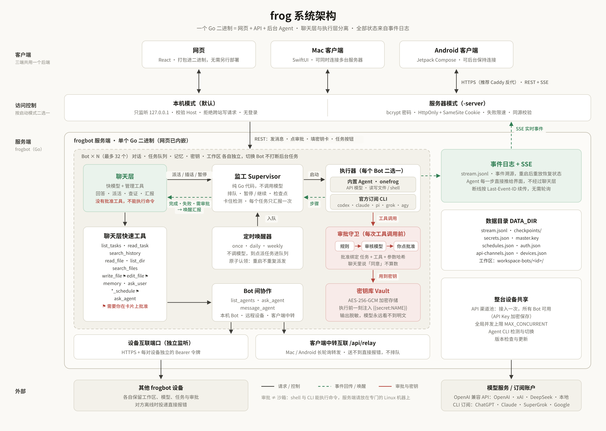

<p align="center"></p>

<h1 align="center">frog bot</h1>

<p align="center">自托管的多 Bot AI 助理：能聊天，也能在后台替你干活 —— 危险操作要你批准，密钥不进模型</p>

<p align="center">
  <a href="https://github.com/llc370219/frog-bot/releases">下载</a> ·
  <a href="docs/backend-and-clients.md">三端接入</a> ·
  <a href="docs/advanced.md">进阶配置</a> ·
  <a href="https://t.me/+pKQYEaxzidU4ZjZh">Telegram 群</a>
</p>

**frog bot 是一个装在你自己服务器上的 AI 助理平台。** 你可以通过网页、Mac 或 Android 同时使用多个 AI 助理。它们平时陪你对话，需要动手时就在后台读写文件、执行命令、按计划定时干活。模型方面，既能接任意 OpenAI 兼容模型，也能直接用你已有的 ChatGPT、Claude 等订阅。所有危险操作都要你亲手批准，密钥加密保存，模型永远看不到明文，数据全部留在你自己的机器上。

## 项目介绍

每个 Bot 分两层：**聊天层**用快模型和你交流、派活、汇报；**后台执行器**负责读写文件、执行命令，可以用内置 Agent（任意 OpenAI 兼容 API），也可以接入你已订阅的 Codex CLI、Claude Code、Pi、Grok CLI、Antigravity CLI。

最多可以建 32 个 Bot，每个 Bot 的对话、任务、记忆、密钥、定时计划和工作区都相互独立。

## 架构逻辑

<p align="center"></p>

服务端是**一个 Go 二进制**，内嵌 React 网页，不依赖数据库。三端共用这一个后端：写操作走 REST，实时更新走 SSE（断线按 `Last-Event-ID` 续传）。

- **聊天层**（`internal/bot/chat.go`）：理解需求、查证事实，用 `start_task` 派活。它没有批准工具，也不能执行命令。
- **监工**（`supervisor.go`）：纯 Go 代码，负责排队、暂停/继续、检查点和卡住检测。任务结束时唤醒聊天层，每个任务只汇报一次。
- **执行器**（`internal/onefrog/`）：在模型和工具之间循环。每一步都通过 SSE 直接推到界面，不经过聊天层。
- **事件日志**（`stream.jsonl`）：所有状态都由事件重放得到，重启后消息、任务、审批全部恢复。

## 项目亮点

- **安全性**：每次工具调用都经过三层审批：写死的规则 → 可选的审核模型 → 你在卡片上点批准。批准记录绑定「任务 + 工具 + 参数哈希」，在聊天里说「同意」不算数。密钥用 AES-256-GCM 加密，模型只能写 `{{secret:NAME}}`，真实值在执行前一刻注入，输出中的密钥（含各种编码）会自动脱敏。服务器模式使用 bcrypt 登录、限速和同源校验。
- **自动化**：多个任务并行跑，超出并发上限自动排队；可以随时插话、暂停、调整顺序。定时任务支持每天、每周和单次，到点自动派活。任务在两步之间的安全点暂停，重启后能从断点继续。
- **Bot / Agent 自定义**：每个 Bot 可以单独设置职责、头像，以及聊天模型和 Agent 模型。Agent 可以切换到官方订阅 CLI，默认屏蔽 API Key 环境变量，避免按量计费。审批策略可调（`untrusted` / `on-request` / `auto` / `never`）。多台设备的 Bot 之间可以互相协作。

> [!WARNING]
> 审批不等于沙箱：Agent 能在服务端机器上执行命令。请把服务端部署在**专门的 Linux 服务器**上。

## 使用方法

| | 是什么 | 运行在哪 |
|---|---|---|
| **服务端** | `frogbot` 本体：Bot、模型调用、Agent 执行和数据都在这里 | 专门的 Linux 服务器（x86_64 / arm64） |
| **客户端** | 网页（服务端自带）、Mac App（macOS 14+）、Android App（8.0+） | 你的电脑和手机 |

模型 Key 和 CLI 登录只保存在服务端，客户端只保存 7 天有效的登录会话。

> [!IMPORTANT]
> **不建议在 Windows 上安装服务端**：服务器模式会对外暴露端口，而 Agent 能在本机执行命令，放在日常使用的电脑上风险很高。Windows 用户请把服务端装在 Linux 服务器上，再用浏览器访问。

**1. 安装服务端**（建议带上域名，自动配置 HTTPS；不带域名时是明文 HTTP）

```bash
curl -fsSL https://raw.githubusercontent.com/llc370219/frog-bot/main/scripts/install.sh | sudo DOMAIN=bot.example.com bash
```

脚本会创建非 root 服务用户并注册 systemd 服务，最后打印访问地址、用户名和初始密码（只显示一次）。重新运行同一条命令即可升级；忘记密码用 `sudo frogbot reset-password`；卸载在命令末尾加 `-s uninstall`。脚本不会修改防火墙，请自行放行 80 / 443 端口。需要用 Docker 部署时见 [进阶配置](docs/advanced.md)。

**2. 配置模型**：登录网页后，在「设置 → API 渠道」填写接口地址和 Key（整台设备只配一次），再到「设置 → 模型与 Agent」为每个 Bot 选择模型或官方订阅 CLI。

**3. 连接客户端**：网页直接打开服务端地址即可。Mac / Android 从 Releases 下载 `clients-v*` 版本，在「设置 → 添加服务器」里填写地址和账号。

## 许可证

[MIT](LICENSE)。界面和素材沿用自 [Onefrog](https://github.com/llc370219/onefrog)，详见 [ATTRIBUTION.md](ATTRIBUTION.md)。
